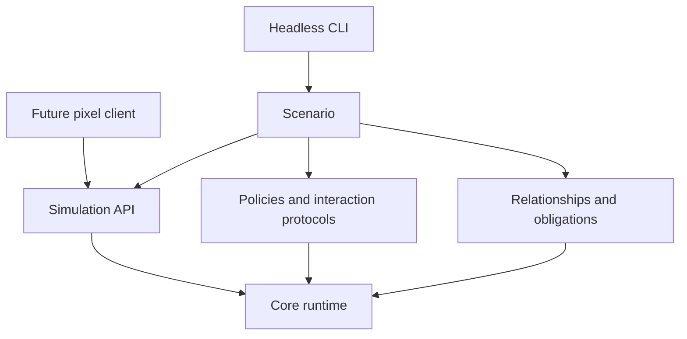

# Architecture

Status: proposed baseline, not implemented. Begin with one Cargo package, a library and a CLI. Split into workspace crates only when boundaries justify the cost.

## Dependency direction

Arrows denote dependencies, not execution order. The core must not import a scenario, graphics, social behavior or a specific economic model.

## Boundaries
- **Core**: stable entity identity, state, tick, scheduling, command validation/resolution, events, controlled randomness, read-only observations.
- **Scenario**: resources, survival, credit, and later zombie mechanics; owns domain rules.
- **Policies**: choose commands from observations; no direct authoritative state mutation.
- **Interactions**: typed stages and composition; persistent multi-tick interactions use explicit state and IDs. Full open-game semantics and equilibrium solvers are optional later extensions.
- **Networks**: sparse directed relationships and indexed obligations; update only affected edges where feasible.
- **Clients**: headless CLI now, pixel and 3D later. Render snapshots and submit commands; do not implement domain rules.
- **Persistence/analytics**: versioned snapshots, deterministic replay and measurements; add when needed.

## Execution contract
1. Read a stable observation snapshot.
2. Collect proposed commands from eligible policies or player input.
3. Validate commands; resolve conflicts in a documented deterministic order.
4. Commit accepted changes atomically at the command level; record rejected commands explicitly.
5. Publish committed events; any follow-up changes must use scheduled commands.
6. Advance simulation time with checked arithmetic.

Start single-threaded. Define the ordering and random-stream semantics before adding concurrency. Composition of strategic games is not equivalent to running systems in parallel; shared state requires explicit conflict resolution.

## Module contract
Each nontrivial module documents: purpose, owned state, public inputs/outputs, command/event types, dependencies, invariants, error behavior, random sources, update cadence, time/space cost and assumptions, tests, known limitations. Add abstractions only when exercised by real use cases.

## Initial implementation
`src/lib.rs` exports the core API; `src/main.rs` is a small CLI demonstration. Add `src/core/` only as code grows. Keep initial dependencies minimal. Evaluate standalone `bevy_ecs` when component storage is actually needed. No full Bevy graphics dependency yet.
